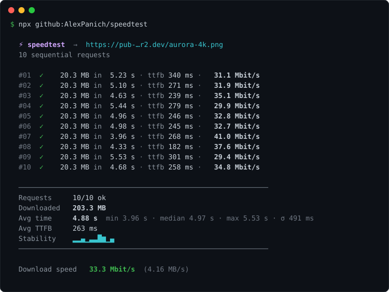

# ⚡ speedtest

[](https://github.com/AlexPanich/speedtest/actions/workflows/ci.yml)


Консольная утилита для замера скорости скачивания. Делает 10 последовательных
запросов к указанному адресу, дожидается полного ответа на каждый и выводит
среднее время запроса, общий объём скачанных данных и итоговую скорость.

<p align="center"></p>

## Быстрый старт

Нужен **Node.js 20+**. Сторонних зависимостей нет, `npm install` не требуется.

```bash
# без клонирования, прямо с GitHub
npx github:AlexPanich/speedtest

# или из исходников
git clone https://github.com/AlexPanich/speedtest.git
cd speedtest
node bin/speedtest.js
```

Без аргументов утилита качает тестовую картинку из Cloudflare R2.
Чтобы проверить другой адрес, передайте его первым аргументом:

```bash
node bin/speedtest.js https://example.com/big-image.jpg
```

Установить глобально как команду `speedtest`:

```bash
npm install -g github:AlexPanich/speedtest   # или `npm link` в папке проекта
speedtest https://example.com/big-image.jpg
```

## Параметры

```
speedtest [url] [options]

  url                    файл для скачивания (по умолчанию — тестовая картинка в R2)
  -n, --count <n>        число последовательных запросов (по умолчанию 10)
  -t, --timeout <sec>    таймаут одного запроса в секундах (по умолчанию 60)
      --json             вывести результат в JSON (для скриптов и CI)
      --no-color         без цветов (переменная NO_COLOR тоже учитывается)
  -v, --version          версия
  -h, --help             справка
```

Пример с JSON:

```bash
node bin/speedtest.js --json | jq .summary
```
```json
{
  "totalBytes": 203314300,
  "avgMs": 4884.12,
  "medianMs": 4970.3,
  "minMs": 3962.5,
  "maxMs": 5533.8,
  "stdevMs": 491.2,
  "avgTtfbMs": 262.9,
  "mbps": 33.3
}
```

Коды выхода: `0` — успех, `1` — ни один запрос не прошёл, `2` — неверные
аргументы, `130` — прервано через Ctrl+C.

## Единицы измерения

| Величина | Единица | Определение |
|---|---|---|
| **Скорость** | **Мбит/с** (`Mbit/s`) | 1 Мбит/с = 1 000 000 бит в секунду |
| Скорость (справочно) | МБ/с (`MB/s`) | 1 МБ/с = 1 000 000 байт в секунду = 8 Мбит/с |
| Объём | МБ (`MB`) | десятичные: 1 MB = 1 000 000 байт |
| Время | мс / с | |

Основная единица — **мегабиты в секунду**: в них скорость указывают провайдеры
и такие сервисы, как Speedtest и fast.com, поэтому результат можно сравнить
напрямую с тарифом. Все приставки десятичные (SI), а не двоичные (MiB).

## Как считается

```
скорость = общий объём (бит) / суммарное время всех запросов (с)
         = средний объём / среднее время
```

- **Время запроса** измеряется от отправки запроса до получения последнего
  байта тела ответа. Оно включает DNS, установку TCP/TLS-соединения (если
  соединение не переиспользуется), ожидание сервера и саму передачу, то есть
  это то время, которое реально ждёт пользователь.
- **TTFB** (time to first byte) — время до получения заголовков ответа. Выводится
  отдельно: по нему видно, какая часть времени уходит на задержку, а какая
  на передачу.
- Скорость считается как **общий объём / общее время**, а не как среднее по
  скоростям отдельных запросов. Так каждый байт имеет одинаковый вес, и
  короткие выбросы не искажают результат.
- Запросы идут **строго последовательно**: следующий начинается только после
  того, как тело предыдущего скачано полностью (это проверяет отдельный тест).
- Отправляется `Accept-Encoding: identity`, чтобы считать байты, реально
  прошедшие по сети, а не размер после распаковки gzip/br.
- Неудачный запрос (HTTP ≠ 2xx, таймаут, ошибка сети) не прерывает серию:
  он помечается `✗` и не учитывается в статистике.
- Помимо среднего выводятся min / median / max и стандартное отклонение σ.
  Строка `Stability` — мини-график скорости по запросам, по ней сразу видно,
  насколько стабилен канал.

## Тестовая картинка

Файл по умолчанию — `aurora-4k.png` (3840×2160, ~20 MB) в бакете Cloudflare R2:
<https://pub-e151508a76d44a9e9d305892e37d7b5c.r2.dev/aurora-4k.png>

<p align="center"></p>

Картинка сгенерирована скриптом [`scripts/generate-image.js`](scripts/generate-image.js)
без зависимостей: PNG-кодер написан с нуля на `node:zlib`. Чтобы файл не сжимался
до нескольких килобайт, поверх градиента наложено «плёночное зерно». Случайный
шум не сжимается, поэтому файл остаётся тяжёлым и при этом выглядит как
картинка, а не как телевизионные помехи. Генератор детерминированный: при
каждом запуске получается побайтово тот же файл.

```bash
npm run generate-image -- aurora-4k.png 3840 2160
```

## Разработка

```bash
npm test        # node:test, локальный HTTP-сервер, без сети
npm run lint    # синтаксическая проверка
```

Тесты проверяют, что делается ровно N запросов и они не пересекаются по
времени, что все байты подсчитаны (в том числе без `Content-Length` и после
редиректа), а также обработку HTTP-ошибок, таймаутов и Ctrl+C. CI гоняет их на
Linux, macOS и Windows с Node 20, 22 и 24.

```
bin/speedtest.js      CLI: аргументы, Ctrl+C, вывод
src/measure.js        один замер: fetch + потоковый подсчёт байт
src/run.js            серия из N последовательных замеров
src/stats.js          агрегирование: среднее, медиана, σ, скорость
src/format.js         единицы, прогресс-бар, sparkline
src/ui.js             отрисовка в терминале (живой прогресс на TTY)
src/colors.js         ANSI-цвета с учётом NO_COLOR / не-TTY
scripts/              генератор тестовой картинки
test/                 тесты
```

## Особенности

- **0 зависимостей**: только стандартная библиотека Node (`fetch`, `parseArgs`, `node:test`).
- **Живой прогресс-бар** с текущей скоростью в интерактивном терминале. При
  выводе в файл или пайп печатаются только итоговые строки, без управляющих
  последовательностей.
- **Ctrl+C** останавливает серию и всё равно печатает статистику по уже
  выполненным запросам. Повторное нажатие сразу завершает программу.
- **`--json`** для автоматизации, понятные коды выхода, поддержка `NO_COLOR`.

## Лицензия

MIT
